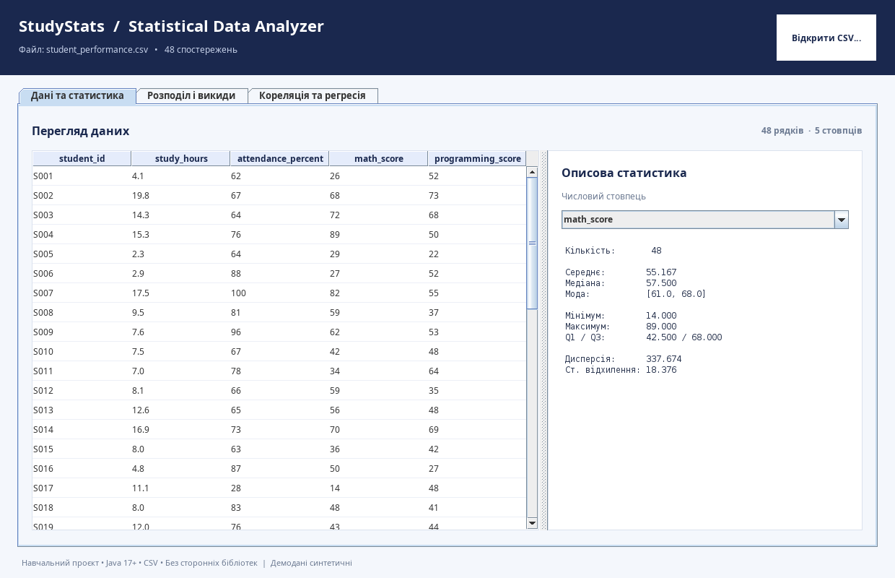
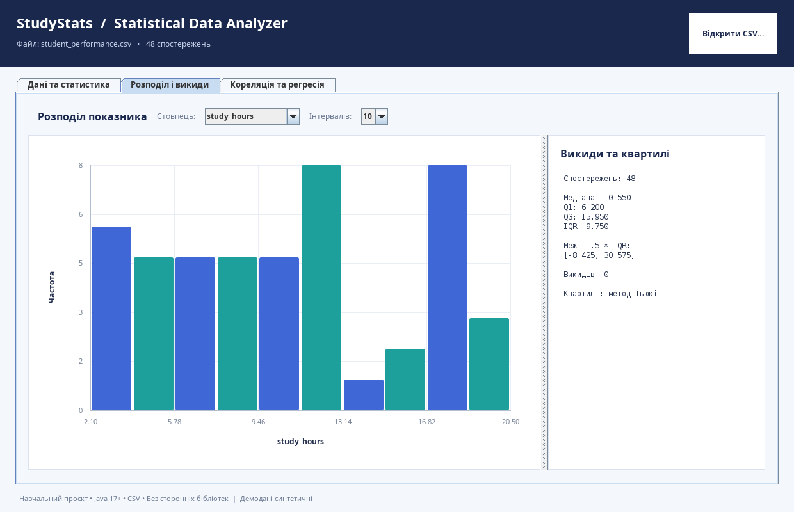
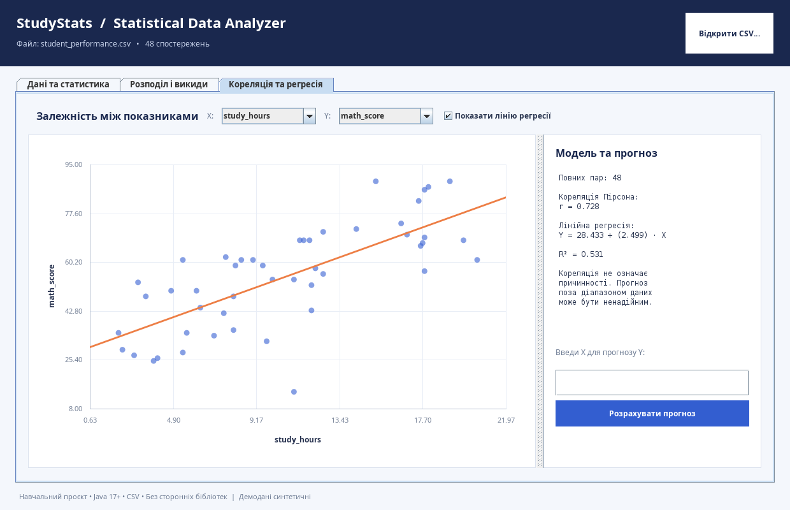

# StudyStats — Statistical Data Analyzer 📊

**StudyStats** — навчальний Java-застосунок для аналізу CSV-даних. Є **графічна desktop-версія (Swing)** з таблицями й інтерактивними графіками, а також окрема **консольна версія**. Працює на **Java 17+ без Python і сторонніх бібліотек**.

## 📷 Вигляд програми

| Дані та статистика | Гістограма та викиди |
|---|---|
|  |  |



## 🚀 Запуск для Windows (найпростіше)

1. Встановіть **JDK 17 або новішу версію**. Підійде Eclipse Temurin JDK 21.
2. Завантажте ZIP і **розпакуйте його повністю** в окрему папку.
3. Відкрийте розпаковану папку `study-stats-java`.
4. Двічі клацніть **`run-gui.bat`** — відкриється вікно програми з трьома вкладками. При першому запуску файли Java компілюються автоматично.
5. Для запуску старої консольної версії використайте **`run.bat`**.

**Важливо:** `.bat` потрібно запускати з **розпакованої папки**, а не з перегляду архіву ZIP. Якщо Windows покаже попередження про невідомий файл, переконайтеся, що ZIP отримано з надійного джерела. Запуск `.bat` виконує локальну компіляцію ваших вихідних файлів і стартує Java. Адміністраторські права не потрібні.

## 🖥️ Що є в графічній версії

| Вкладка | Можливості |
|---|---|
| **Дані та статистика** | Таблиця CSV (можна сортувати рядки); середнє, медіана, мода, квартилі, дисперсія й стандартне відхилення для обраного числового стовпця |
| **Розподіл і викиди** | Гістограма, вибір кількості інтервалів, квартилі, інтерквартильний розмах, межі 1.5×IQR, список викидів |
| **Кореляція та регресія** | Діаграма розсіювання, кореляція Пірсона `r`, лінія регресії, рівняння `Y = a + bX`, коефіцієнт детермінації `R²`, прогноз Y для заданого X |

Натисніть **«Відкрити CSV…»**, щоб завантажити свій файл. Файл має кодування UTF-8, роздільник `,` і десяткову крапку (наприклад, `12.5`). Назви стовпців повинні бути у першому рядку. Пропущені значення дозволено залишати порожніми; при парному аналізі використовуються лише повні пари.

**Власний набір даних:** стандартний файл `data/student_performance.csv` містить 48 **синтетичних** студентських записів, не реальні персональні дані. Він використовується для демонстрації можливостей і не підтверджує причинно-наслідкових зв'язків.

## 📌 Запуск в інших ОС

```bash
bash run-gui.sh  # віконна версія
bash run.sh      # консольна версія
bash test.sh     # тести
```

Запуск віконної програми без скрипта (після компіляції):

```bash
java -cp out ua.studystats.DesktopApp
```

## 🧪 Тести

На Windows двічі клацніть `test.bat`. На Linux/macOS виконайте `bash test.sh`. У GitHub Actions налаштована збірка й автоматичне тестування змін (Java 17).

## 📂 Структура проєкту

```text
study-stats-java/
├── .github/workflows/java-ci.yml
├── data/student_performance.csv
├── src/main/java/ua/studystats/
│   ├── Main.java             # Консольне меню
│   ├── DesktopApp.java       # Графічний застосунок Swing
│   ├── ChartPanel.java       # Гістограма і scatter plot через Java2D
│   ├── CsvDataset.java       # Імпорт та робота з CSV
│   └── Statistics.java       # Статистичні алгоритми
├── src/test/java/ua/studystats/StatisticsTest.java
├── run-gui.bat                # GUI на Windows ← ЗАПУСТІТЬ ЦЕ
├── run-gui.sh                 # GUI на Linux/macOS
├── run.bat / run.sh          # Консольна версія
└── test.bat / test.sh        # Тести
```

## 📐 Математика

- Середнє: `x̄ = Σxi / n`.
- Вибіркова дисперсія: `s² = Σ(xi − x̄)² / (n − 1)`.
- Кореляція Пірсона: `r = Σ(xi−x̄)(yi−ȳ) / √[Σ(xi−x̄)² × Σ(yi−ȳ)²]`.
- Лінійна регресія методом найменших квадратів: `Ŷ = a + bX`.
- Викиди: значення за межами `[Q1−1.5×IQR, Q3+1.5×IQR]` (квартилі за методом Тьюкі).

## Обмеження й інтерпретація

Це **навчальний інструмент**; `R²` і кореляція описують зв'язок, а не причинність. Лінійний прогноз поза діапазоном X може бути ненадійним. CSV із крапкою з комою, десятковою комою чи багаторядковими цитованими полями наразі не підтримується. Стовпець визнається числовим, лише якщо всі непорожні значення в ньому — коректні скінченні числа.

## Ідеї для наступних версій

Експорт звіту, збереження графіків у PNG, нові види графіків, довірчі інтервали та тести гіпотез.
